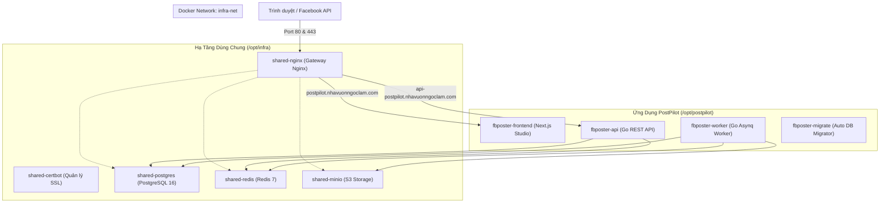

# Báo Cáo Triển Khai Hệ Thống PostPilot Lên VPS

Tài liệu này tóm tắt toàn bộ công việc đã thực hiện trong quá trình thiết lập hạ tầng, cấu hình Docker Compose, Nginx Gateway, và triển khai dự án **PostPilot** lên máy chủ VPS.

---

## 1. Thông Tin Môi Trường Máy Chủ (VPS)

- **SSH Host Alias**: `eztech` (kết nối qua SSH key `~/.ssh/eztech-vps`)
- **IP VPS**: `116.118.6.104`
- **Hệ điều hành**: Ubuntu 24.04 LTS (Noble Numbat)
- **Tài nguyên**: 4 GB RAM, 2 GB Swap, 33 GB Disk (trống 25+ GB)
- **Công nghệ đã cài đặt**:
  - Docker Engine `29.9.2`
  - Docker Compose Plugin `v5.6.0`
  - Tường lửa `UFW` (Chỉ mở: Port `22/SSH`, Port `80/HTTP`, Port `443/HTTPS`)

---

## 2. Kiến Trúc Phân Tách 2 Stack Độc Lập

Để đảm bảo các dịch vụ hạ tầng có thể **dùng chung cho nhiều dự án khác trong tương lai**, hệ thống đã được chia tách thành 2 Docker Compose stack riêng biệt kết nối qua Docker bridge network `infra-net`:



### Chi tiết 2 Stack:

| Thư mục trên VPS | File Compose | Danh sách Containers | Chức năng |
| :--- | :--- | :--- | :--- |
| **`/opt/infra`** | `docker-compose.yml` | `shared-nginx`<br>`shared-certbot`<br>`shared-postgres`<br>`shared-redis`<br>`shared-minio` | Cung cấp cổng Gateway Internet, quản lý SSL, cơ sở dữ liệu, hàng đợi và lưu trữ S3 dùng chung cho toàn VPS. |
| **`/opt/postpilot`** | `docker-compose.prod.yml` | `fbposter-frontend`<br>`fbposter-api`<br>`fbposter-worker`<br>`fbposter-migrate` | Chạy ứng dụng PostPilot. Khi cập nhật code/restart app, hạ tầng không hề bị gián đoạn. |

---

## 3. Cấu Hình 2 Tên Miền Độc Lập (Decoupled Routing)

Hệ thống được cấu hình tách biệt hoàn toàn để tránh xung đột đường dẫn:

1. **Frontend App:** `postpilot.nhavuonngoclam.com`
   - Trỏ trực tiếp vào **Next.js Studio** (`fbposter-frontend:3000`).
   - Mọi request, route, và server actions của Next.js chạy độc lập.
2. **Backend API & S3 Storage:** `api-postpilot.nhavuonngoclam.com`
   - Trỏ vào **Go REST API** (`fbposter-api:8080`).
   - Đường dẫn `/fb-media/` phục vụ trực tiếp file ảnh/video từ **MinIO S3** (`shared-minio:9000/fb-media/`) cho Facebook Graph API.
   - Bật CORS cho phép gọi từ Frontend.

---

## 4. Trạng Thái Hoạt Động Hiện Tại Trên VPS

Tất cả 8 containers đều đang ở trạng thái **`Up`** và sẵn sàng:

```bash
$ docker ps --format "table {{.Names}}\t{{.Status}}\t{{.Ports}}"

NAMES               STATUS                    IMAGE
fbposter-frontend   Up (Next.js Studio)       ghcr.io/truonghoang2004/postpilot-frontend:sha-98a3190
fbposter-api        Up (Go REST API)          ghcr.io/truonghoang2004/postpilot-backend:sha-98a3190
fbposter-worker     Up (Go Asynq Worker)      ghcr.io/truonghoang2004/postpilot-backend:sha-98a3190
shared-nginx        Up (Gateway)              nginx:1.31.7-alpine
shared-certbot      Up (SSL Auto-renew)       certbot/certbot:v5.8.0
shared-minio        Up (MinIO S3)             quay.io/minio/aistor/minio:RELEASE.2026-09-19T17-05-25Z
shared-postgres     Up (healthy)              postgres:16-alpine
shared-redis        Up (healthy)              redis:7-alpine
```

**Kiểm tra phản hồi thực tế qua Nginx:**
- `curl -I -H "Host: postpilot.nhavuonngoclam.com" http://116.118.6.104/` ➡️ **200 OK (Next.js)**
- `curl -I -H "Host: api-postpilot.nhavuonngoclam.com" http://116.118.6.104/healthz` ➡️ **200 OK (Go Backend)**

---

## 5. Bước Cần Hoàn Tất Tiếp Theo

### Bước 1: Trỏ 2 bản ghi A Record trên Namecheap
Đăng nhập vào Namecheap (quản lý domain `nhavuonngoclam.com`), vào **Advanced DNS** và thêm:
* **Host**: `postpilot` | **Type**: `A` | **Value**: `116.118.6.104` | **TTL**: `1 min`
* **Host**: `api-postpilot` | **Type**: `A` | **Value**: `116.118.6.104` | **TTL**: `1 min`

### Bước 2: Kích hoạt SSL (Let's Encrypt HTTPS)
Sau khi DNS nhận, chạy lệnh kích hoạt tự động:
```bash
ssh eztech "/opt/infra/setup-ssl.sh your-email@gmail.com"
```
*(Lệnh này sẽ tự động gọi Certbot cấp chứng chỉ cho cả 2 domain, sửa cấu hình Nginx sang HTTPS và reload Nginx).*

---

## 6. Sổ Tay Lệnh Vận Hành Nhanh

- **Xem log hệ thống PostPilot:**
  ```bash
  ssh eztech "cd /opt/postpilot && docker compose -f docker-compose.prod.yml logs -f --tail=100"
  ```
- **Cập nhật phiên bản mới PostPilot:**
  ```bash
  ssh eztech "cd /opt/postpilot && docker compose -f docker-compose.prod.yml pull && docker compose -f docker-compose.prod.yml up -d"
  ```
- **Sao lưu cơ sở dữ liệu PostgreSQL:**
  ```bash
  ssh eztech "docker exec -t shared-postgres pg_dump -U fbposter fb_autoposter" > backup_$(date +%F).sql
  ```
- **Mở MinIO Web Console từ máy tính:**
  ```bash
  ssh -L 9001:localhost:9001 eztech
  ```
  Truy cập `http://localhost:9001` trên trình duyệt máy bạn.
