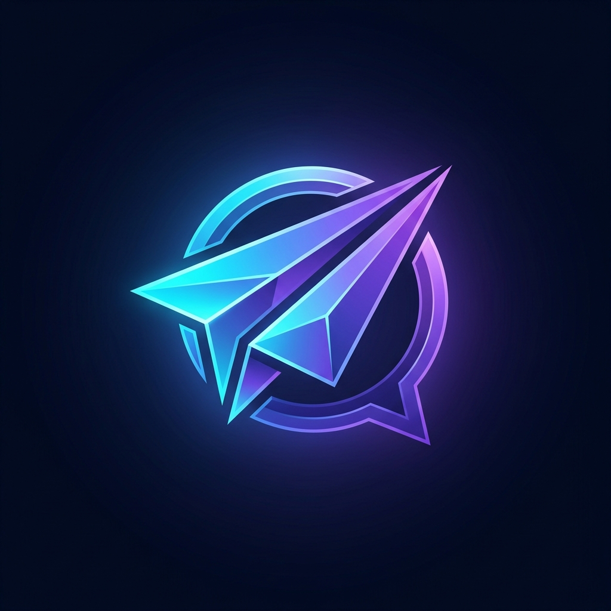
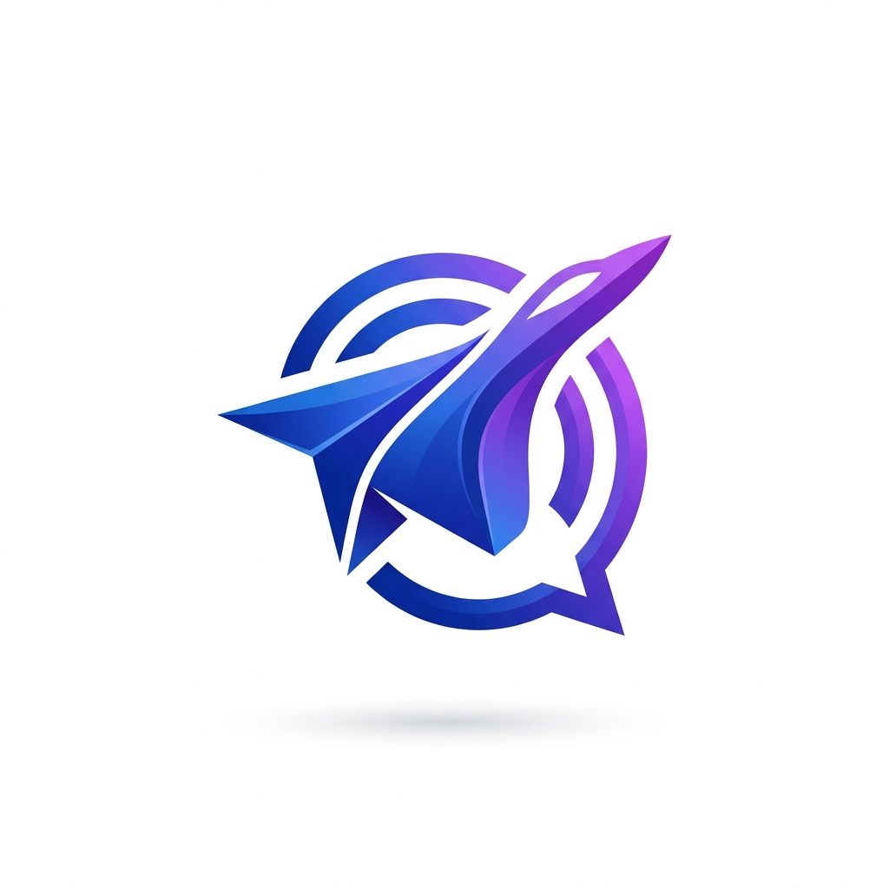

<p align="center">
  
  &nbsp;&nbsp;&nbsp;&nbsp;
  
</p>

<h1 align="center">✈️ PostPilot - Hệ Thống Đăng Bài Tự Động Facebook</h1>

<p align="center">
  <b>Hạ tầng Go 1.26 + Redis Queue + Docker Compose + AI Content Studio</b>
</p>

---

Hệ thống **PostPilot** chuẩn Production được xây dựng hoàn toàn bằng **Golang (Go 1.26)** và đóng gói hạ tầng bằng **Docker Compose**. Hệ thống giao tiếp chính thống với **Meta Graph API v20.0**, hỗ trợ quản lý đa Fanpage, mã hóa Token chuẩn **AES-256-GCM**, phân tầng hàng đợi **Redis Queue (`FAST` / `HEAVY`)**, tự động điều tiết **Rate Limit**, và tích hợp **AI (Google Gemini)** để sáng tạo nội dung tự động.

---

## 📚 Mục lục Tài liệu Hệ thống

Để nắm bắt toàn bộ thiết kế và cách vận hành, bạn có thể đọc theo thứ tự các tài liệu chi tiết trong thư mục [`docs/`](file:///Users/truonghoang/Documents/antigravity/happy-darwin/docs):

1. **[Kiến trúc Hệ thống & Cơ sở dữ liệu (`docs/ARCHITECTURE.md`)](file:///Users/truonghoang/Documents/antigravity/happy-darwin/docs/ARCHITECTURE.md)**: Sơ đồ luồng dữ liệu, thiết kế các bảng PostgreSQL, cơ chế khóa dòng chống trùng lặp (`SELECT ... FOR UPDATE SKIP LOCKED`), thuật toán Exponential Backoff Retry và kiểm soát Rate-Limit.
2. **[Đặc tả RESTful API & Ví dụ cURL (`docs/API_SPEC.md`)](file:///Users/truonghoang/Documents/antigravity/happy-darwin/docs/API_SPEC.md)**: Chi tiết toàn bộ các API quản lý Fanpage, tạo lịch đăng bài, tạo Presigned URL upload ảnh/video và gọi AI viết bài.
3. **[Hướng dẫn Setup Meta App & Lấy Token Vĩnh Viễn (`docs/META_SETUP_GUIDE.md`)](file:///Users/truonghoang/Documents/antigravity/happy-darwin/docs/META_SETUP_GUIDE.md)**: Từng bước cấu hình trên `developers.facebook.com` và cách dùng API của hệ thống để đổi sang **Permanent Page Access Token** (không bao giờ hết hạn).
4. **[Sổ tay Vận hành & Đưa lên Cloud (`docs/OPERATIONS_RUNBOOK.md`)](file:///Users/truonghoang/Documents/antigravity/happy-darwin/docs/OPERATIONS_RUNBOOK.md)**: Hướng dẫn triển khai lên Cloud, cách scale nhiều Worker, bảng tra cứu mã lỗi Meta Graph API và cảnh báo Telegram.

---

## 🗂 Cấu trúc Thư mục Dự án

```text
happy-darwin/
├── Dockerfile                         # Multi-stage Dockerfile đóng gói 3 binary: fb-api, fb-worker, fb-migrate
├── docker-compose.yml                 # Hạ tầng đầy đủ: PostgreSQL 16, Redis 7, MinIO (S3), Migrator, API, Worker
├── Makefile                           # Các lệnh tắt: build, test, migrate-up, migrate-status, docker-up
├── .env.example                       # Cấu hình mẫu đầy đủ các biến môi trường
├── migrations/                        # Quản lý Database Schema Migration (nhúng vào binary qua embed.FS)
│   ├── embed.go                       # Nhúng *.sql vào binary Golang
│   ├── 000001_init_schema.up.sql      # Bảng facebook_pages, media_assets, posts, publish_logs
│   ├── 000001_init_schema.down.sql    # Rollback migration 000001
│   ├── 000002_add_rate_limits_and_webhooks.up.sql   # Bảng webhook_events & ai_generation_logs
│   └── 000002_add_rate_limits_and_webhooks.down.sql # Rollback migration 000002
├── cmd/                               # Các Entrypoint thực thi của hệ thống
│   ├── api/main.go                    # HTTP REST API Server + Giao diện Web Admin Dashboard (Port 8080)
│   ├── worker/main.go                 # Background Cron Scheduler + Fast/Heavy Queue Workers + Token Health Checker
│   └── migrate/main.go                # Công cụ CLI chạy Database Migration bằng Golang (up, down, status)
└── internal/                          # Các tầng nghiệp vụ cốt lõi (Clean Architecture)
    ├── config/config.go               # Đọc cấu hình từ .env và biến môi trường
    ├── crypto/aes.go                  # Mã hóa & giải mã Page Access Token bằng AES-256-GCM
    ├── domain/models.go               # Các thực thể Domain: FacebookPage, Post, MediaAsset, PublishLog
    ├── database/
    │   ├── pgdriver/driver.go         # Native PostgreSQL v3 Wire Protocol driver (SCRAM-SHA-256, MD5, Simple Query)
    │   ├── migrator.go                # Engine thực thi SQL Migration tự động bằng Golang
    │   └── repository.go              # Repository thao tác PostgreSQL + InMemoryStore fallback
    ├── infra/
    │   ├── redis/client.go            # Redis Queue Client (LPUSH/BRPOP) + Rate-Limit Cache
    │   ├── storage/s3_minio.go        # Ký AWS Signature V4 Presigned PUT URL cho S3 / MinIO / Cloudflare R2
    │   ├── notifier/telegram.go       # Gửi cảnh báo thời gian thực qua Telegram Bot
    │   └── ai/gemini.go               # Tích hợp Google Gemini API tự động viết nội dung bài đăng
    ├── facebook/
    │   ├── client.go                  # HTTP Client gọi Meta Graph API v20.0 & đọc Header X-Page-Usage
    │   ├── auth.go                    # Luồng OAuth2 & đổi Short-lived -> Long-lived -> Permanent Page Token
    │   ├── publisher.go               # Engine đăng bài: Text, Link, Single Photo, Multi-Photo Album, Chunked Video, Reels
    │   └── errors.go                  # Phân loại mã lỗi Meta (Retryable vs Non-Retryable, Code 190, 32, 368)
    ├── worker/
    │   ├── scheduler.go               # Quét bài đến hạn đăng & kiểm tra sức khỏe Token định kỳ
    │   └── processor.go               # Xử lý hàng đợi FAST/HEAVY, điều tiết Rate-Limit & Exponential Backoff
    └── api/
        ├── server.go                  # HTTP Router & Middleware (CORS, Logging, Recovery)
        ├── handlers.go                # Các RESTful API Handlers
        └── ui_dashboard.go            # Giao diện Web Control Center tích hợp sẵn tại http://localhost:8080
```

---

## ⚡ Hướng dẫn Khởi chạy Nhanh (Quickstart)

### Cách 1: Chạy toàn bộ hạ tầng bằng Docker Compose (Khuyên dùng)

1. Tạo file `.env` từ file mẫu:
   ```bash
   cp .env.example .env
   ```
2. Khởi động toàn bộ cụm dịch vụ (PostgreSQL, Redis, MinIO, Golang Migrator, API Server, Background Worker):
   ```bash
   make docker-up
   # Hoặc chạy trực tiếp:
   docker compose up -d --build
   ```
3. Truy cập các giao diện quản trị:
   * **Web Control Center & API Server:** `http://localhost:8080`
   * **Health Check API:** `http://localhost:8080/healthz`
   * **MinIO Console (Quản lý kho Ảnh/Video S3):** `http://localhost:9001` (User: `minioadmin` / Pass: `minioadmin123`)

---

### Cách 2: Chạy và Kiểm thử trực tiếp bằng Golang trên máy Local

Hệ thống được thiết kế **Zero External Dependency Blocker**: ngay cả khi bạn chưa bật Docker, API Server vẫn có thể khởi chạy ngay lập tức với chế độ `InMemoryStore` fallback để bạn trải nghiệm giao diện và test luồng API.

1. **Chạy toàn bộ Unit Test & End-to-End Test:**
   ```bash
   make test
   # Hoặc: go test -v ./...
   ```
2. **Biên dịch 3 file thực thi (`bin/fb-api`, `bin/fb-worker`, `bin/fb-migrate`):**
   ```bash
   make build
   ```
3. **Quản lý Database Migration bằng Golang (khi đã bật PostgreSQL):**
   ```bash
   make migrate-status   # Xem trạng thái các bản migration
   make migrate-up       # Áp dụng các bản migration mới nhất
   make migrate-down     # Rollback 1 phiên bản migration gần nhất
   ```
4. **Chạy API Server, Worker và Next.js Studio:**
   ```bash
   make run-api          # Chạy Backend API Server (Port 8080)
   make run-worker       # Chạy Background Worker & Scheduler
   make frontend-dev     # Chạy Next.js Studio UI (Port 3000)
   ```

5. **Truy cập ứng dụng:**
   * **Next.js Studio UI (Khuyên dùng):** `http://localhost:3000`
   * **Golang API & Embedded Dashboard:** `http://localhost:8080`
   * **Healthcheck & Queue Stats:** `http://localhost:8080/healthz`
   * **MinIO Console (S3 Storage):** `http://localhost:9001`

