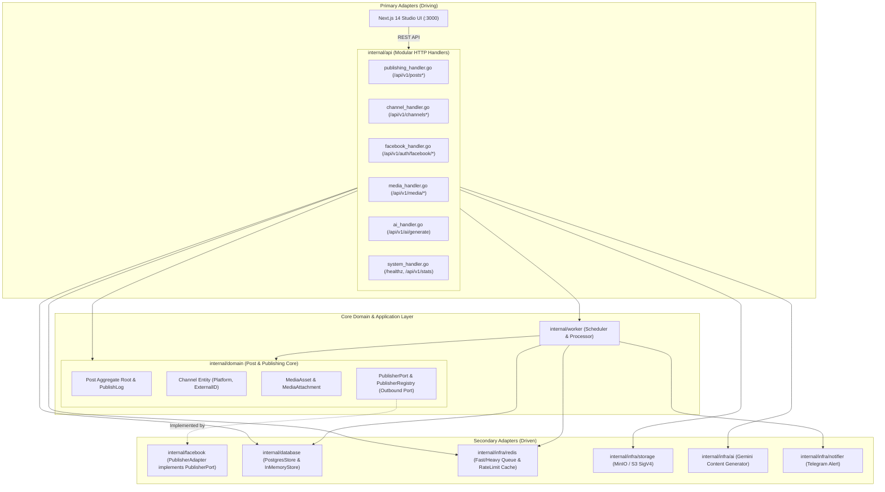
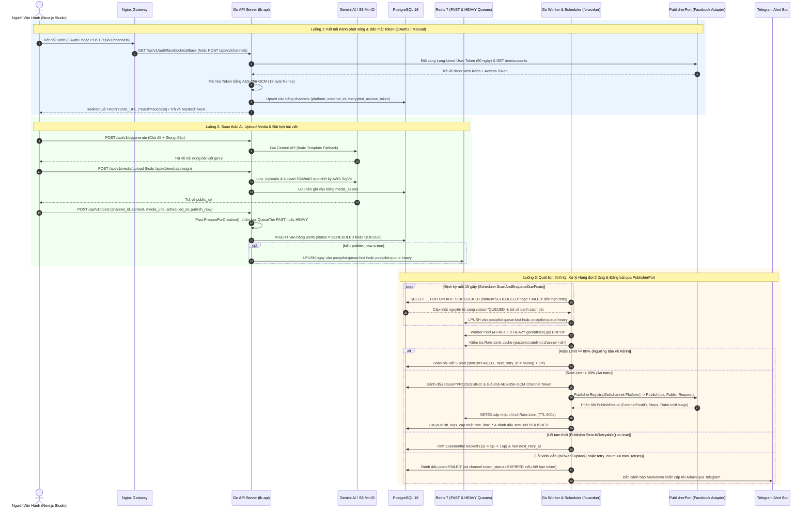
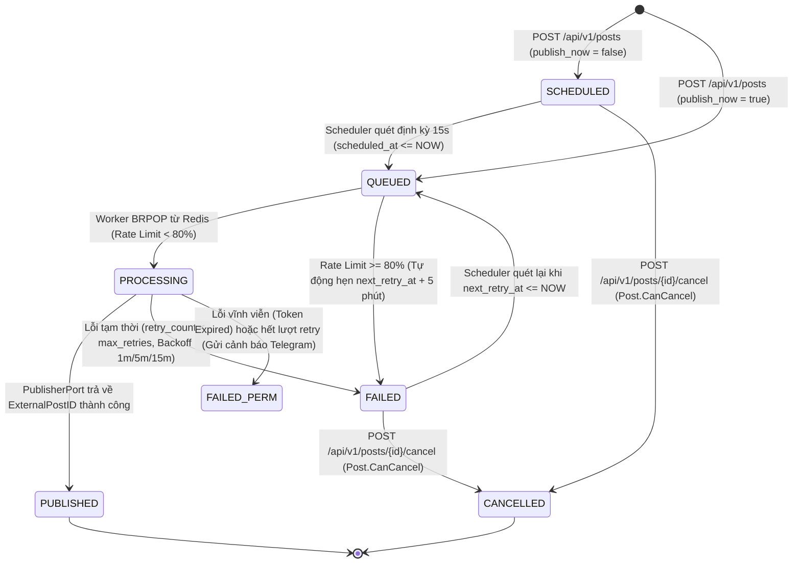
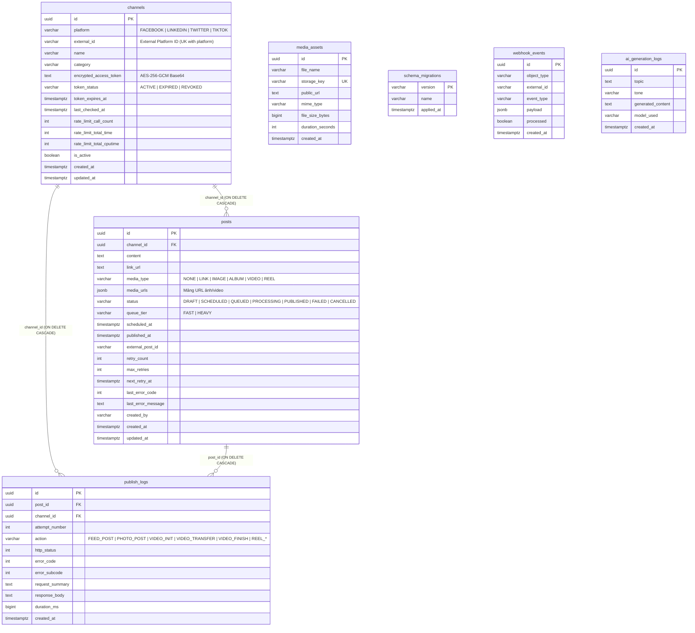

# 🏗 Kiến Trúc Tổng Thể Hệ Thống PostPilot (DDD, Hexagonal & Infrastructure Architecture)

Tài liệu này mô tả toàn diện kiến trúc **Domain-Driven Design (DDD)** và **Hexagonal Architecture (Ports & Adapters)** của dự án **PostPilot**, phân ranh giới các Bounded Contexts, mô hình dữ liệu (Database & Queue), vòng đời trạng thái bài đăng, và kiến trúc triển khai hạ tầng Production (2-Stack Docker Compose & CI/CD).

---

## 1. Cấu Trúc Thư Mục Toàn Dự Án (Repository Tree)

```text
PostPilot/
├── cmd/                                # 3 Binary Entrypoints của Golang Backend
│   ├── api/main.go                     # HTTP REST API Server (:8080) & Embedded UI
│   ├── worker/main.go                  # Background Cron Scheduler & Queue Worker
│   └── migrate/main.go                 # Database Schema Migration CLI (up/down/status)
├── internal/                           # Core Backend Packages (Zero external Go dependencies)
│   ├── domain/                         # CORE DOMAIN: Post & Publishing (Platform-agnostic)
│   │   ├── channel.go                  # Channel Entity, PlatformType, RateLimitUsage, TokenStatus
│   │   ├── media.go                    # MediaAsset, MediaAttachment, MediaType & QueueTier Routing
│   │   ├── post.go                     # Post Aggregate Root, PublishLog, PublishJobPayload & Invariants
│   │   └── ports.go                    # Outbound Ports: PublisherPort, PublisherError, PublisherRegistry
│   ├── api/                            # PRIMARY ADAPTER: Modular HTTP Handlers by Bounded Context
│   │   ├── server.go                   # Router, Dependency Injection, Middleware (CORS, Logging, Recovery)
│   │   ├── publishing_handler.go       # Publishing Context (/api/v1/posts*)
│   │   ├── channel_handler.go          # Channel Context (/api/v1/channels*)
│   │   ├── facebook_handler.go         # Facebook Auth & Webhook Adapter (/api/v1/auth/facebook/*, /api/v1/webhooks/facebook)
│   │   ├── media_handler.go            # Media Context (/api/v1/media/*)
│   │   ├── ai_handler.go               # AI Content Context (/api/v1/ai/generate)
│   │   ├── system_handler.go           # Observability Context (/healthz, /api/v1/stats)
│   │   └── ui_dashboard.go             # Embedded HTML Dashboard
│   ├── facebook/                       # SECONDARY ADAPTER: Meta Graph API v20.0 implementing PublisherPort
│   │   ├── adapter.go                  # PublisherAdapter (implements domain.PublisherPort)
│   │   ├── client.go                   # HTTP Client, Rate-Limit Header Parser (X-Page-Usage)
│   │   ├── auth.go                     # OAuth2, Token Exchange (60 ngày) & Debug Token
│   │   ├── publisher.go                # Đăng Text, Link, Photo, Album, Chunked Video & Reel
│   │   └── errors.go                   # GraphAPIError (implements domain.PublisherError)
│   ├── worker/                         # APPLICATION ORCHESTRATION: Queue Worker & Cron Scheduler
│   │   ├── scheduler.go                # Quét bài đến hạn (FOR UPDATE SKIP LOCKED) & Check Token qua PublisherRegistry
│   │   └── processor.go                # Worker Pool 2 tầng (FAST / HEAVY) gọi PublisherPort & Exponential Backoff
│   ├── database/                       # SECONDARY ADAPTER: Repository & Custom Postgres Driver
│   │   ├── repository.go               # Store interface, PostgresStore & InMemoryStore fallback
│   │   ├── migrator.go                 # Quản lý bảng schema_migrations
│   │   └── pgdriver/driver.go          # Custom PostgreSQL Wire Protocol v3.0 Driver (SCRAM-SHA-256)
│   ├── infra/                          # SECONDARY ADAPTERS: Hạ tầng kỹ thuật
│   │   ├── redis/client.go             # Custom RESP2 TCP Client (postpilot:queue:fast/heavy) + Memory Fallback
│   │   ├── storage/s3_minio.go         # Custom AWS Signature V4 Presigned PUT & Direct Upload
│   │   ├── ai/gemini.go                # Google Gemini Content Generator + Template Fallback
│   │   └── notifier/telegram.go        # Cảnh báo vận hành qua Telegram Bot API
│   ├── config/                         # Đọc cấu hình từ .env và biến môi trường
│   │   └── config.go
│   └── crypto/                         # Mã hóa Token bằng AES-256-GCM & Masking
│       └── aes.go
├── migrations/                         # SQL Migrations nhúng vào binary qua //go:embed
│   ├── embed.go
│   ├── 000001_init_schema.{up,down}.sql
│   ├── 000002_add_rate_limits_and_webhooks.{up,down}.sql
│   └── 000003_refactor_channels_schema.{up,down}.sql
├── frontend/                           # Next.js 14 App Router Studio UI (:3000)
│   └── src/
│       ├── app/                        # RootLayout (layout.tsx) & Main Studio Page (page.tsx)
│       ├── components/                 # Header, StatsCards, PostComposer, PostList, PageManager, PostDetailModal
│       ├── context/                    # ThemeContext (Dark/Light) & DialogContext (Modal/Toast)
│       └── lib/                        # API Client (api.ts), TypeScript Interfaces (types.ts), Utils
├── infra/                              # Shared Infrastructure Stack (/opt/infra trên VPS)
│   ├── docker-compose.yml              # shared-nginx, shared-certbot, shared-postgres, shared-redis, shared-minio
│   └── nginx/                          # Cấu hình Gateway Reverse Proxy tách 2 tên miền
│       ├── nginx.conf
│       └── conf.d/{frontend,backend}.conf
├── .github/workflows/                  # CI/CD Pipeline
│   └── docker-publish.yml              # Tự động build & push Backend/Frontend images lên GHCR
├── Dockerfile                          # Multi-stage build cho 3 Go binaries (fb-api, fb-worker, fb-migrate)
├── docker-compose.yml                  # Môi trường phát triển Local đầy đủ
└── docker-compose.prod.yml             # Stack ứng dụng Production (/opt/postpilot trên VPS)
```

---

## 2. Sơ Đồ Kiến Trúc DDD & Hexagonal (Ports & Adapters Graph)

Trong kiến trúc mới, **`internal/domain`** là trung tâm độc lập hoàn toàn với các nền tảng mạng xã hội. `internal/worker` và `internal/api` giao tiếp với các nền tảng bên ngoài thông qua giao diện trừu tượng `domain.PublisherPort` và `domain.PublisherRegistry`. Module `internal/facebook` đóng vai trò là một **Secondary Adapter** thực thi `domain.PublisherPort`:



---

## 3. Kiến Trúc Hạ Tầng Triển Khai & CI/CD (2-Stack Production Topology)

Hệ thống Production trên VPS được phân tách thành **2 Docker Compose Stack độc lập** kết nối qua mạng nội bộ `infra-net`, kết hợp với luồng tự động build image qua **GitHub Actions (GHCR)**:


---

## 4. Sơ Đồ Luồng Xử Lý Nghiệp Vụ End-to-End (Sequence Diagram)



---

## 5. Vòng Đời Trạng Thái Bài Viết (Post State Machine)

Được định nghĩa trong [`internal/domain/post.go`](../internal/domain/post.go) và điều phối bởi [`internal/worker/scheduler.go`](../internal/worker/scheduler.go) cùng [`internal/worker/processor.go`](../internal/worker/processor.go):



---

## 6. Sơ Đồ Thực Thể Cơ Sở Dữ Liệu (PostgreSQL ER Diagram)

Cơ sở dữ liệu PostgreSQL 16 gồm 7 bảng được quản lý qua các bản migration `000001`, `000002` và `000003_refactor_channels_schema`:



---

## 7. Các Quyết Định Thiết Kế Kỹ Thuật Đặc Trưng Của Codebase

1. **DDD & Hexagonal Architecture (Ports & Adapters)**:
   - Core Domain (`internal/domain`) định nghĩa các khái niệm trừu tượng (`Channel`, `Post`, `MediaAsset`, `MediaAttachment`, `PublisherPort`, `PublisherError`).
   - Mọi tương tác mạng xã hội đều đi qua `PublisherPort`, cho phép bổ sung các adapter mới (LinkedIn, TikTok, X) mà không phải sửa đổi logic trong `internal/worker` hay `internal/domain`.
2. **Zero External Go Dependencies (`go.mod` thuần Standard Library)**:
   - **PostgreSQL Driver tự viết** (`internal/database/pgdriver/driver.go`): Cài đặt trực tiếp giao thức PostgreSQL Wire Protocol v3.0 qua TCP, hỗ trợ xác thực `SCRAM-SHA-256`, `MD5` và Simple Query Protocol.
   - **Redis RESP2 Client tự viết** (`internal/infra/redis/client.go`): Giao tiếp TCP trực tiếp bằng giao thức RESP2 (`LPUSH`, `BRPOP`, `LLEN`, `SETEX`, `GET`, `DEL`).
   - **S3 AWS Signature V4 tự viết** (`internal/infra/storage/s3_minio.go`): Tự tính toán chữ ký `AWS4-HMAC-SHA256` để tạo Presigned PUT URL và upload trực tiếp lên MinIO/AWS S3.
3. **Cơ chế Graceful In-Memory Fallback**:
   - Khi chạy local/test mà không bật PostgreSQL hoặc Redis, cả `fb-api` và `fb-worker` tự động chuyển sang `InMemoryStore` và bộ nhớ đệm trong `redis.Client`.
4. **Bảo mật Token bằng AES-256-GCM** (`internal/crypto/aes.go`):
   - Access Token của mọi `Channel` luôn được mã hóa xác thực bằng `AES-256-GCM` với Nonce 12-byte ngẫu nhiên trước khi lưu xuống DB và luôn bị ẩn (`json:"-"`) khi trả JSON qua REST API, chỉ hiển thị chuỗi che `MaskToken`.
5. **Chống trùng lặp khi Scale nhiều Worker (`SELECT ... FOR UPDATE SKIP LOCKED`)**:
   - Hàm `PostgresStore.ClaimDuePosts` sử dụng CTE nguyên tử kết hợp khóa dòng `FOR UPDATE SKIP LOCKED`, đảm bảo nhiều container `fb-worker` chạy song song không bao giờ bốc trùng một bài đăng.
6. **Hàng đợi 2 tầng (`FAST` vs `HEAVY`) & Bảo vệ Rate-Limit tự động**:
   - Tách biệt hàng đợi `postpilot:queue:fast` (4 goroutines cho Text, Link, Ảnh, Album) và `postpilot:queue:heavy` (2 goroutines cho Video Chunked 3 bước & Reels).
   - Tự động cập nhật `RateLimitUsage` từ adapter sau mỗi lần gọi API và chủ động hoãn bài đăng 5 phút nếu mức sử dụng chạm ngưỡng `80%`.
