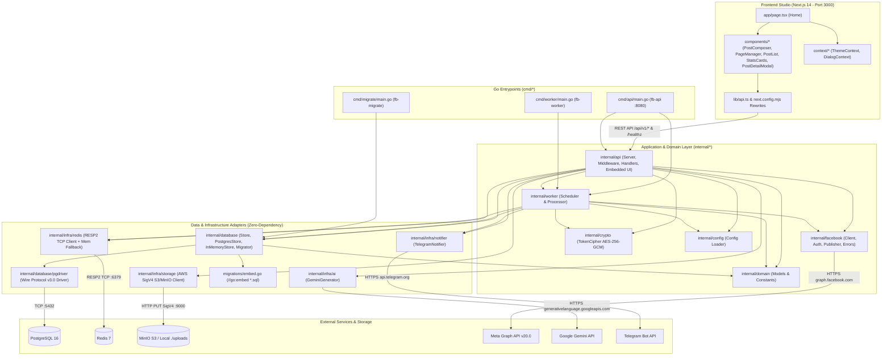
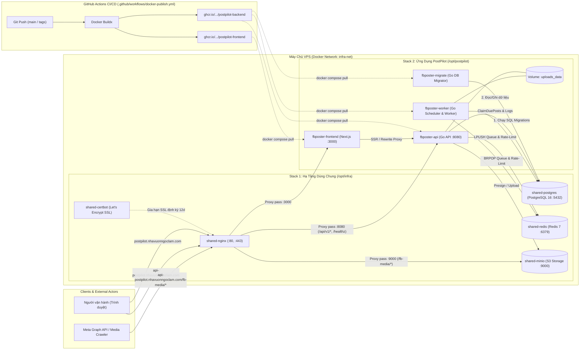
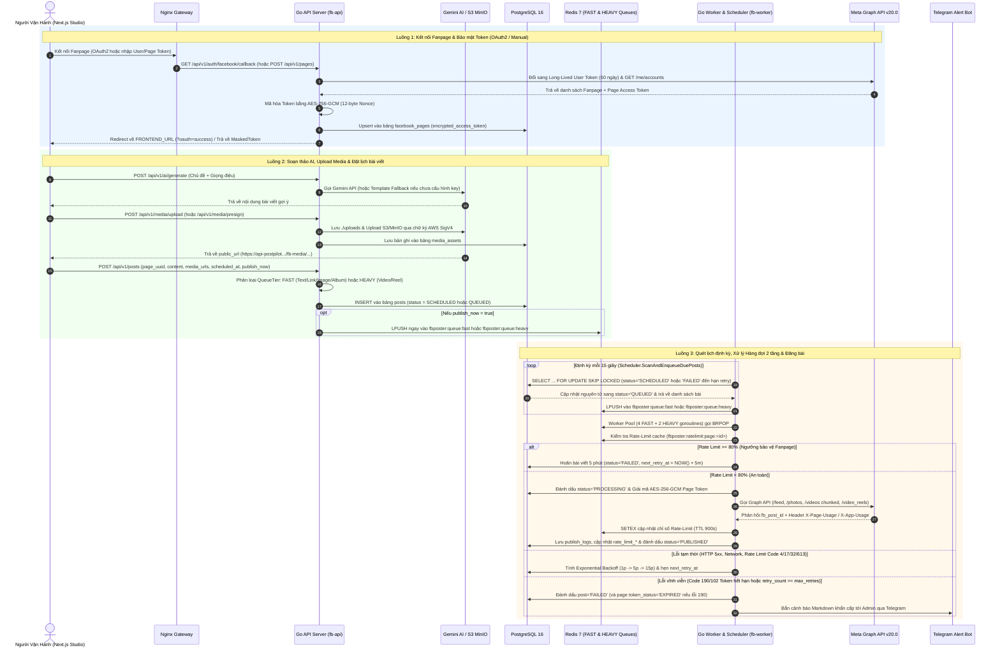
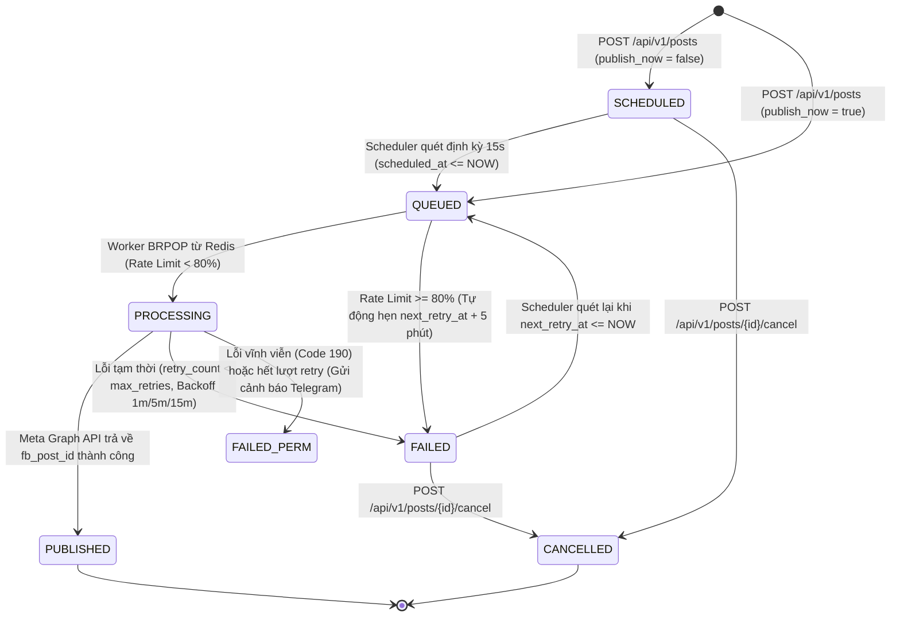

# 🏗 Kiến Trúc Tổng Thể Hệ Thống PostPilot (Codebase & Infrastructure Architecture)

Tài liệu này mô tả toàn diện kiến trúc mã nguồn, sự phụ thuộc giữa các package (Go Backend & Next.js Frontend), mô hình dữ liệu (Database & Queue), vòng đời trạng thái bài đăng, và kiến trúc triển khai hạ tầng Production (2-Stack Docker Compose & CI/CD).

---

## 1. Cấu Trúc Thư Mục Toàn Dự Án (Repository Tree)

```text
PostPilot/
├── cmd/                                # 3 Binary Entrypoints của Golang Backend
│   ├── api/main.go                     # HTTP REST API Server (:8080) & Embedded UI
│   ├── worker/main.go                  # Background Cron Scheduler & Queue Worker
│   └── migrate/main.go                 # Database Schema Migration CLI (up/down/status)
├── internal/                           # Core Backend Packages (Zero external Go dependencies)
│   ├── api/                            # HTTP Router, Middleware, REST v1 Handlers, Embedded HTML
│   │   ├── server.go
│   │   ├── handlers.go
│   │   └── ui_dashboard.go
│   ├── config/                         # Đọc cấu hình từ .env và biến môi trường
│   │   └── config.go
│   ├── crypto/                         # Mã hóa Token bằng AES-256-GCM & Masking
│   │   └── aes.go
│   ├── database/                       # Repository Pattern, Migrator & Custom Postgres Driver
│   │   ├── repository.go               # Store interface, PostgresStore & InMemoryStore fallback
│   │   ├── migrator.go                 # Quản lý bảng schema_migrations
│   │   └── pgdriver/driver.go          # Custom PostgreSQL Wire Protocol v3.0 Driver (SCRAM-SHA-256)
│   ├── domain/                         # Domain Entities, Enums & DTOs
│   │   └── models.go
│   ├── facebook/                       # Tích hợp Meta Graph API v20.0
│   │   ├── client.go                   # HTTP Client, Rate-Limit Header Parser (X-Page-Usage)
│   │   ├── auth.go                     # OAuth2, Token Exchange (60 ngày) & Debug Token
│   │   ├── publisher.go                # Đăng Text, Link, Photo, Album, Chunked Video & Reel
│   │   └── errors.go                   # Phân loại lỗi GraphAPIError (Retryable vs Token Invalid)
│   ├── infra/                          # Các Adapter kết nối dịch vụ hạ tầng
│   │   ├── redis/client.go             # Custom RESP2 TCP Client (LPUSH/BRPOP/SETEX) + Memory Fallback
│   │   ├── storage/s3_minio.go         # Custom AWS Signature V4 Presigned PUT & Direct Upload
│   │   ├── ai/gemini.go                # Google Gemini Content Generator + Template Fallback
│   │   └── notifier/telegram.go        # Cảnh báo vận hành qua Telegram Bot API
│   └── worker/                         # Điều phối & Xử lý hàng đợi bất đồng bộ
│       ├── scheduler.go                # Quét bài đến hạn (FOR UPDATE SKIP LOCKED) & Check Token
│       └── processor.go                # Worker Pool 2 tầng (FAST / HEAVY) & Exponential Backoff
├── migrations/                         # SQL Migrations nhúng vào binary qua //go:embed
│   ├── embed.go
│   ├── 000001_init_schema.{up,down}.sql
│   └── 000002_add_rate_limits_and_webhooks.{up,down}.sql
├── frontend/                           # Next.js 14 App Router Studio UI (:3000)
│   └── src/
│       ├── app/                        # RootLayout (layout.tsx) & Main Studio Page (page.tsx)
│       ├── components/                 # Header, StatsCards, PostComposer, PostList, PageManager, PostDetailModal
│       ├── context/                    # ThemeContext (Dark/Light) & DialogContext (Modal/Toast)
│       └── lib/                        # API Client (api.ts), TypeScript Interfaces (types.ts), Utils
├── infra/                              # Shared Infrastructure Stack (/opt/infra trên VPS)
│   ├── docker-compose.yml              # shared-nginx, shared-certbot, shared-postgres, shared-redis, shared-minio
│   └── nginx/                          # Cấu hình Gateway Reverse Proxy tách 2 tên miền
│       ├── nginx.conf
│       └── conf.d/{frontend,backend}.conf
├── nginx/                              # Cấu hình Nginx mẫu tại repo root
├── .github/workflows/                  # CI/CD Pipeline
│   └── docker-publish.yml              # Tự động build & push Backend/Frontend images lên GHCR
├── Dockerfile                          # Multi-stage build cho 3 Go binaries (fb-api, fb-worker, fb-migrate)
├── docker-compose.yml                  # Môi trường phát triển Local đầy đủ
└── docker-compose.prod.yml             # Stack ứng dụng Production (/opt/postpilot trên VPS)
```

---

## 2. Sơ Đồ Kiến Trúc Module & Dependency (Codebase Component Graph)

Sơ đồ dưới đây thể hiện mối quan hệ giữa **Frontend Next.js**, **3 Go Executables (`cmd/*`)**, các **Internal Packages (`internal/*`)** và các hệ thống bên ngoài:



---

## 3. Kiến Trúc Hạ Tầng Triển Khai & CI/CD (2-Stack Production Topology)

Hệ thống Production trên VPS được phân tách thành **2 Docker Compose Stack độc lập** kết nối qua mạng nội bộ `infra-net`, kết hợp với luồng tự động build image qua **GitHub Actions (GHCR)**:



---

## 4. Sơ Đồ Luồng Xử Lý Nghiệp Vụ End-to-End (Sequence Diagram)



---

## 5. Vòng Đời Trạng Thái Bài Viết (Post State Machine)

Được định nghĩa trong [`internal/domain/models.go`](file:///Users/truonghoang/Documents/dev/personal/PostPilot/internal/domain/models.go#L19-L27) và điều phối bởi [`internal/worker/scheduler.go`](file:///Users/truonghoang/Documents/dev/personal/PostPilot/internal/worker/scheduler.go#L78-L105) cùng [`internal/worker/processor.go`](file:///Users/truonghoang/Documents/dev/personal/PostPilot/internal/worker/processor.go#L106-L238):



---

## 6. Sơ Đồ Thực Thể Cơ Sở Dữ Liệu (PostgreSQL ER Diagram)

Cơ sở dữ liệu PostgreSQL 16 gồm 7 bảng được khởi tạo tự động qua [`migrations/000001_init_schema.up.sql`](file:///Users/truonghoang/Documents/dev/personal/PostPilot/migrations/000001_init_schema.up.sql) và [`migrations/000002_add_rate_limits_and_webhooks.up.sql`](file:///Users/truonghoang/Documents/dev/personal/PostPilot/migrations/000002_add_rate_limits_and_webhooks.up.sql):

```mermaid
erDiagram
    facebook_pages ||--o{ posts : "page_uuid (ON DELETE CASCADE)"
    facebook_pages ||--o{ publish_logs : "page_uuid (ON DELETE CASCADE)"
    posts ||--o{ publish_logs : "post_id (ON DELETE CASCADE)"

    facebook_pages {
        uuid id PK
        varchar page_id UK "Facebook Page ID"
        varchar page_name
        varchar category
        text encrypted_access_token "AES-256-GCM Base64"
        varchar token_status "ACTIVE | EXPIRED | REVOKED"
        timestamptz token_expires_at
        timestamptz last_checked_at
        int rate_limit_call_count
        int rate_limit_total_time
        int rate_limit_total_cputime
        boolean is_active
        timestamptz created_at
        timestamptz updated_at
    }

    posts {
        uuid id PK
        uuid page_uuid FK
        text content
        text link_url
        varchar media_type "NONE | LINK | IMAGE | ALBUM | VIDEO | REEL"
        jsonb media_urls "Mảng URL ảnh/video"
        varchar status "DRAFT | SCHEDULED | QUEUED | PROCESSING | PUBLISHED | FAILED | CANCELLED"
        varchar queue_tier "FAST | HEAVY"
        timestamptz scheduled_at
        timestamptz published_at
        varchar fb_post_id
        int retry_count
        int max_retries
        timestamptz next_retry_at
        int last_error_code
        text last_error_message
        varchar created_by
        timestamptz created_at
        timestamptz updated_at
    }

    publish_logs {
        uuid id PK
        uuid post_id FK
        uuid page_uuid FK
        int attempt_number
        varchar action "FEED_POST | PHOTO_POST | VIDEO_INIT | VIDEO_TRANSFER | VIDEO_FINISH | REEL_*"
        int http_status
        int fb_error_code
        int fb_error_subcode
        text request_summary
        text response_body
        bigint duration_ms
        timestamptz created_at
    }

    media_assets {
        uuid id PK
        varchar file_name
        varchar storage_key UK
        text public_url
        varchar mime_type
        bigint file_size_bytes
        int duration_seconds
        timestamptz created_at
    }

    schema_migrations {
        varchar version PK
        varchar name
        timestamptz applied_at
    }

    webhook_events {
        uuid id PK
        varchar object_type
        varchar page_id
        varchar event_type
        jsonb payload
        boolean processed
        timestamptz created_at
    }

    ai_generation_logs {
        uuid id PK
        text topic
        varchar tone
        text generated_content
        varchar model_used
        timestamptz created_at
    }
```



---

## 7. Các Quyết Định Thiết Kế Kỹ Thuật Đặc Trưng Của Codebase

1. **Zero External Go Dependencies (`go.mod` thuần Standard Library)**:
   - **PostgreSQL Driver tự viết** ([`internal/database/pgdriver/driver.go`](file:///Users/truonghoang/Documents/dev/personal/PostPilot/internal/database/pgdriver/driver.go)): Cài đặt trực tiếp giao thức PostgreSQL Wire Protocol v3.0 qua TCP, hỗ trợ xác thực `SCRAM-SHA-256`, `MD5` và Simple Query Protocol.
   - **Redis RESP2 Client tự viết** ([`internal/infra/redis/client.go`](file:///Users/truonghoang/Documents/dev/personal/PostPilot/internal/infra/redis/client.go)): Giao tiếp TCP trực tiếp bằng giao thức RESP2 (`LPUSH`, `BRPOP`, `LLEN`, `SETEX`, `GET`, `DEL`).
   - **S3 AWS Signature V4 tự viết** ([`internal/infra/storage/s3_minio.go`](file:///Users/truonghoang/Documents/dev/personal/PostPilot/internal/infra/storage/s3_minio.go)): Tự tính toán chữ ký `AWS4-HMAC-SHA256` để tạo Presigned PUT URL và upload trực tiếp lên MinIO/AWS S3.
2. **Cơ chế Graceful In-Memory Fallback**:
   - Khi chạy local/test mà không bật PostgreSQL hoặc Redis, cả `fb-api` và `fb-worker` tự động chuyển sang [`InMemoryStore`](file:///Users/truonghoang/Documents/dev/personal/PostPilot/internal/database/repository.go#L497-L503) và bộ nhớ đệm trong [`redis.Client`](file:///Users/truonghoang/Documents/dev/personal/PostPilot/internal/infra/redis/client.go#L30-L39). Ngoài ra `fb-api` nhúng sẵn một [`worker.Processor`](file:///Users/truonghoang/Documents/dev/personal/PostPilot/cmd/api/main.go#L64) để hỗ trợ đăng đồng bộ (`?sync=true`).
3. **Bảo mật Token bằng AES-256-GCM** ([`internal/crypto/aes.go`](file:///Users/truonghoang/Documents/dev/personal/PostPilot/internal/crypto/aes.go#L17-L105)):
   - Page Access Token luôn được mã hóa xác thực bằng `AES-256-GCM` với Nonce 12-byte ngẫu nhiên trước khi lưu xuống DB và luôn bị ẩn (`json:"-"`) khi trả JSON qua REST API, chỉ hiển thị chuỗi che [`MaskToken`](file:///Users/truonghoang/Documents/dev/personal/PostPilot/internal/crypto/aes.go#L107-L116).
4. **Chống trùng lặp khi Scale nhiều Worker (`SELECT ... FOR UPDATE SKIP LOCKED`)**:
   - Hàm [`PostgresStore.ClaimDuePosts`](file:///Users/truonghoang/Documents/dev/personal/PostPilot/internal/database/repository.go#L308-L343) sử dụng CTE nguyên tử kết hợp khóa dòng `FOR UPDATE SKIP LOCKED`, đảm bảo nhiều container `fb-worker` chạy song song không bao giờ bốc trùng một bài đăng.
5. **Hàng đợi 2 tầng (`FAST` vs `HEAVY`) & Bảo vệ Rate-Limit tự động**:
   - Tách biệt hàng đợi `fbposter:queue:fast` (4 goroutines cho Text, Link, Ảnh, Album) và `fbposter:queue:heavy` (2 goroutines cho Video Chunked 3 bước & Reels) để các tác vụ upload video nặng không gây nghẽn bài đăng thông thường.
   - Tự động đọc header `X-Page-Usage` và `X-App-Usage` sau mỗi lần gọi Meta API ([`ParseRateLimitHeaders`](file:///Users/truonghoang/Documents/dev/personal/PostPilot/internal/facebook/client.go#L182-L204)) và chủ động hoãn bài đăng 5 phút nếu mức sử dụng chạm ngưỡng `80%`.
