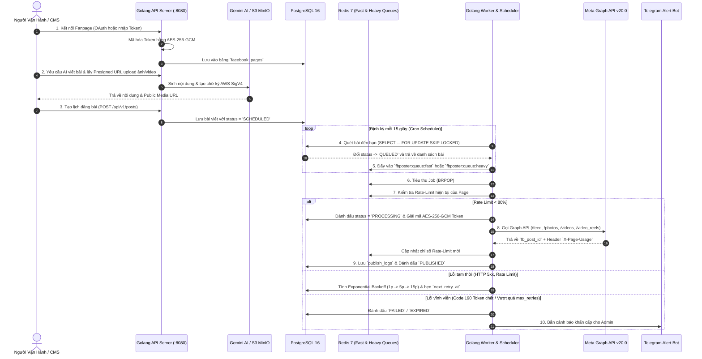

# 🏗 Tài liệu Kiến trúc Hệ thống (System Architecture)

Tài liệu này mô tả chi tiết cách thiết kế hạ tầng, cơ sở dữ liệu và luồng xử lý bên trong hệ thống **Facebook Auto-Poster** viết bằng Golang.

---

## 1. Sơ đồ Luồng Hoạt động Tổng thể



---

## 2. Các Quyết định Thiết kế Kỹ thuật Trọng tâm

### 2.1. Hệ thống Migration viết bằng Golang (`internal/database/migrator.go`)
* Toàn bộ các file SQL trong thư mục [`migrations/`](file:///Users/truonghoang/Documents/antigravity/happy-darwin/migrations) được nhúng trực tiếp vào binary Golang thông qua `//go:embed *.sql` ([`migrations/embed.go`](file:///Users/truonghoang/Documents/antigravity/happy-darwin/migrations/embed.go)).
* Bảng `schema_migrations` theo dõi chính xác những phiên bản nào đã được áp dụng (`000001`, `000002`...).
* Khi triển khai bằng Docker hoặc trên Cloud, container `migrate` sẽ tự động chạy `/app/fb-migrate up` trước khi `api` và `worker` khởi động.

### 2.2. Bảo mật Token bằng AES-256-GCM (`internal/crypto/aes.go`)
* Facebook Page Access Token có quyền đăng bài trực tiếp lên Fanpage nên tuyệt đối không được lưu dạng rõ (plaintext) trong cơ sở dữ liệu.
* Hệ thống sử dụng thuật toán mã hóa xác thực **AES-256-GCM** với Nonce ngẫu nhiên 12-byte cho mỗi lần mã hóa.
* Khi trả danh sách Fanpage qua API (`GET /api/v1/pages`), trường `EncryptedAccessToken` bị ẩn hoàn toàn (`json:"-"`) và chỉ hiển thị chuỗi đã che `MaskedToken` (ví dụ: `EAABsb...9876`).

### 2.3. Chống đăng trùng bài khi chạy nhiều Worker (`SELECT ... FOR UPDATE SKIP LOCKED`)
Trong hàm [`PostgresStore.ClaimDuePosts`](file:///Users/truonghoang/Documents/antigravity/happy-darwin/internal/database/repository.go), hệ thống sử dụng câu truy vấn nguyên tử (Atomic CTE):
```sql
WITH due AS (
    SELECT id
    FROM posts
    WHERE (status = 'SCHEDULED' AND scheduled_at <= $1)
       OR (status = 'FAILED' AND retry_count < max_retries AND next_retry_at IS NOT NULL AND next_retry_at <= $1)
    ORDER BY scheduled_at ASC
    LIMIT $2
    FOR UPDATE SKIP LOCKED
)
UPDATE posts p
SET status = 'QUEUED', updated_at = NOW()
FROM due
WHERE p.id = due.id
RETURNING p.id, p.page_uuid, p.queue_tier, p.retry_count::text;
```
Nhờ `FOR UPDATE SKIP LOCKED`, dù bạn có scale lên 5 hay 10 container `worker` chạy song song trên Cloud, không bao giờ có 2 worker bốc trùng cùng 1 bài viết.

### 2.4. Kiến trúc Hàng đợi 2 tầng (`FAST` vs `HEAVY` Queue)
* **`FAST Queue` (`fbposter:queue:fast`):** Xử lý các bài đăng Text, Link, 1 Ảnh hoặc Album nhiều ảnh. Thời gian xử lý trung bình chỉ 1–3 giây/bài. Mặc định chạy 4 worker song song.
* **`HEAVY Queue` (`fbposter:queue:heavy`):** Xử lý các bài đăng Video dung lượng lớn (Chunked Upload) và Facebook Reels. Việc tách riêng giúp một video nặng 200MB đang upload không bao giờ làm chậm các bài đăng tin tức/ảnh thông thường.

### 2.5. Tự động đọc Header Rate-Limit của Meta (`internal/facebook/client.go`)
* Mỗi phản hồi HTTP từ Meta Graph API đều kèm theo header `X-Page-Usage` và `X-App-Usage` có dạng:
  ```json
  {"call_count": 28, "total_cputime": 15, "total_time": 22}
  ```
* Hệ thống tự động bóc tách 3 chỉ số này sau mỗi request, lưu vào Redis với TTL 15 phút và cập nhật vào bảng `facebook_pages`.
* Trước khi đăng bài mới, nếu chỉ số sử dụng của Fanpage vượt ngưỡng `RATE_LIMIT_THRESHOLD_PERCENT` (mặc định `80%`), Worker sẽ chủ động hoãn bài đăng lại 5 phút để bảo vệ Fanpage khỏi bị Meta khóa tính năng tạm thời.

---

## 3. Thiết kế Chi tiết Cơ sở Dữ liệu (PostgreSQL Schema)

| Tên bảng | Mục đích | Các cột quan trọng |
| :--- | :--- | :--- |
| **`schema_migrations`** | Lưu lịch sử chạy Golang Migration | `version` (PK), `name`, `applied_at` |
| **`facebook_pages`** | Danh sách Fanpage & Token mã hóa | `id` (UUID), `page_id` (Unique), `page_name`, `encrypted_access_token`, `token_status`, `rate_limit_*` |
| **`media_assets`** | Quản lý file ảnh/video trên S3/MinIO | `id` (UUID), `file_name`, `storage_key`, `public_url`, `mime_type`, `file_size_bytes` |
| **`posts`** | Nội dung bài viết & Lịch hẹn giờ | `id` (UUID), `page_uuid` (FK), `content`, `media_type`, `media_urls` (JSONB), `status`, `queue_tier`, `scheduled_at`, `fb_post_id`, `retry_count`, `next_retry_at` |
| **`publish_logs`** | Nhật ký từng bước gọi Meta API | `id` (UUID), `post_id` (FK), `attempt_number`, `action`, `http_status`, `fb_error_code`, `request_summary`, `response_body`, `duration_ms` |
| **`webhook_events`** | Lưu sự kiện Webhook từ Meta | `id` (UUID), `object_type`, `page_id`, `event_type`, `payload` (JSONB), `processed` |
